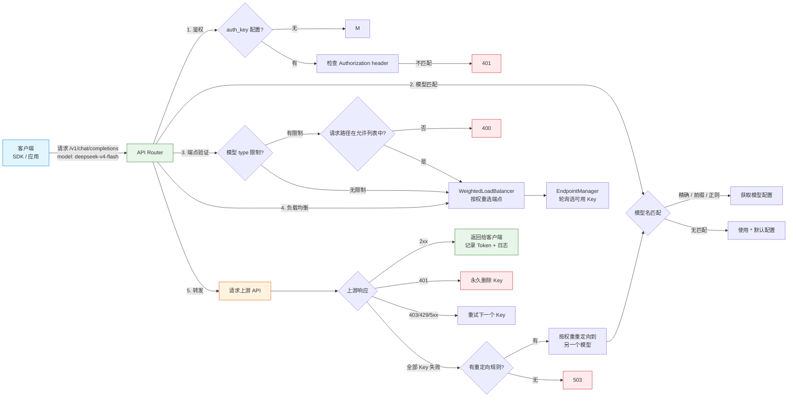
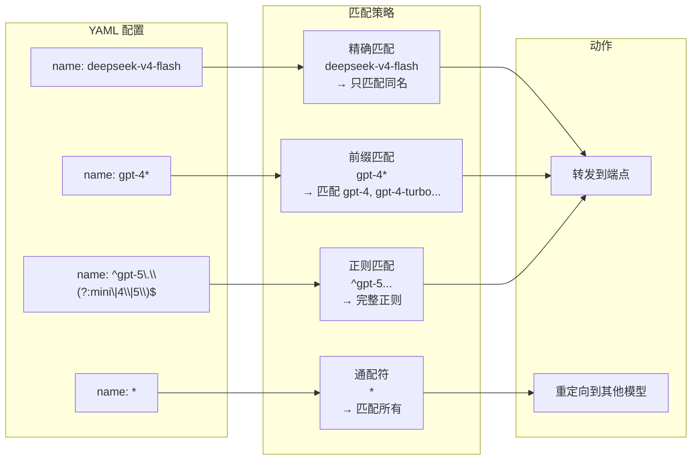
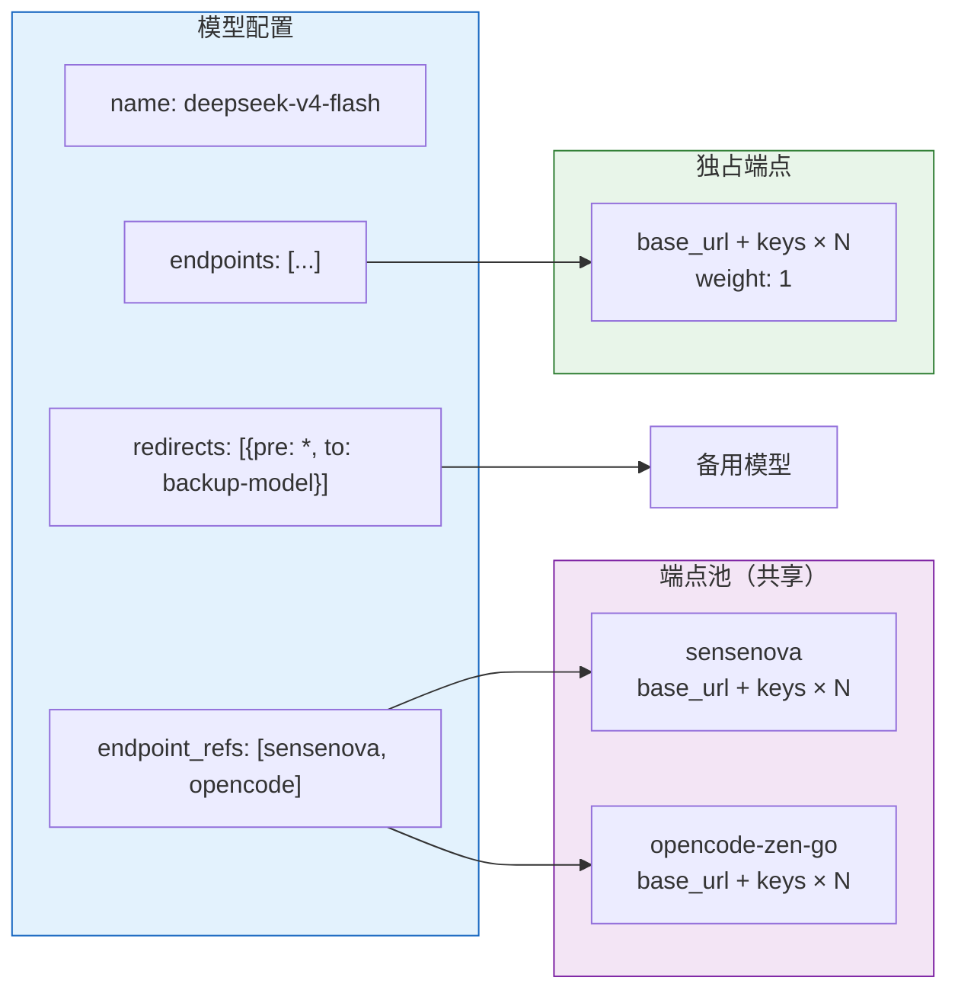
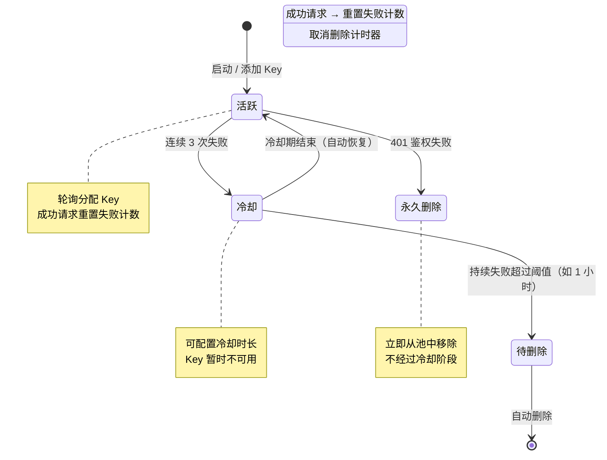
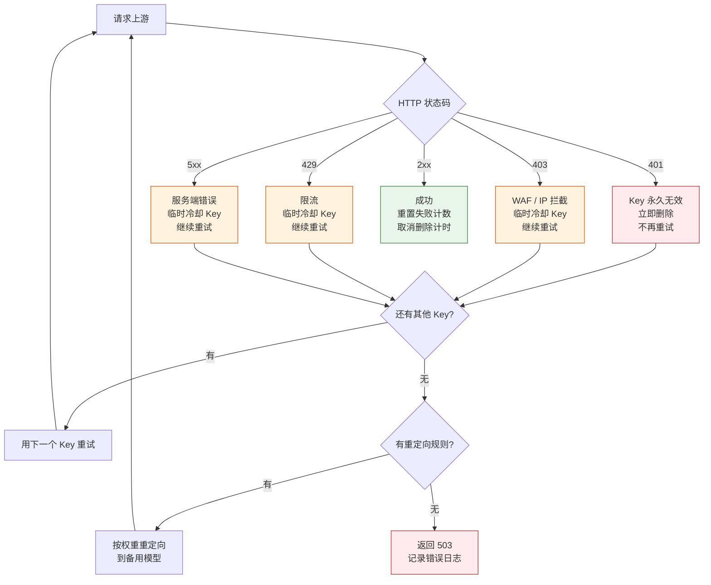
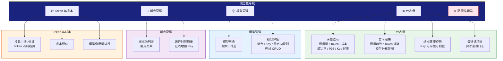

# API Router — 智能 AI API 网关

> 把你的 API Key 交给我们，把模型路由交给路由。

**API Router** 是一个高性能、轻量级的 AI API 反向代理网关，专为 LLM 调用场景设计。它位于客户端（如 Crush、Cursor、OpenAI SDK）与上游 AI 提供商之间，提供透明、智能的请求路由、故障转移、负载均衡和实时运维控制台。

## 快速开始

```bash
# 启动服务
deno run --allow-net --allow-env --allow-read --allow-write src/main.ts

# 控制台输出
🔧 API Router by JiXieShi
🌐 https://www.starss.cc
API Router listening on http://localhost:8080
Admin: http://localhost:8080/admin
```

## 核心特性

- **智能模型路由** — 按模型名精确、前缀或正则匹配，透明转发到正确的上游端点
- **企业级 Key 管理** — 多 Key 轮询、自动冷却、401 永久删除、持续失败自动移除
- **智能重试与故障转移** — 可配置重试和超时；所有端点不可用时按权重重定向到备用模型
- **实时运维控制台** — 5 页面 SPA，内置仪表盘、模型管理、端点管理、Token 成本分析、配置编辑器
- **OpenAI 完全兼容** — 支持 `/v1/chat/completions`、`/v1/embeddings`、`/v1/images/generations`、`/v1/responses`、`/v1/messages`（Claude 兼容）
- **配置热加载** — 无需重启，配置变更自动生效
- **成本追踪** — 集成 `models.dev` 模型目录，自动获取最新定价，实时估算每次请求成本
- **零 npm 依赖** — 纯 Deno 2 + TypeScript，单二进制编译

## 请求生命周期

客户端的一次请求，经过 API Router 的完整流转路径：



## 模型路由与匹配

API Router 支持 4 种模型匹配策略，灵活适配各种命名场景：



### 端点配置方式

每个模型可以灵活组合端点来源：



## Key 智能管理

API Router 的核心能力之一是自动化的 API Key 生命周期管理：



### 错误处理策略

不同的上游响应状态码触发不同的处理逻辑：



## 管理控制台

5 页面 SPA 运维控制台，无需构建工具，即开即用：



## 配置示例大全

以下示例覆盖所有核心功能场景，可直接组合使用。

### 基础模型 — 独占端点

```yaml
models:
  - name: gpt-4o
    endpoints:
      - base_url: https://api.openai.com/v1
        keys:
          - sk-proj-xxxxx
        weight: 1
        timeout: 120
        max_retries: 3
```

### 共享端点池 — 多模型复用 Key

```yaml
endpoint_pool:
  sensenova:
    base_url: https://token.sensenova.cn/v1
    keys:
      - sk-sensenova-key-1
      - sk-sensenova-key-2
    weight: 1
  opencode-free:
    base_url: https://opencode.ai/zen/v1
    keys:
      - sk-opencode-key-1
    weight: 1

models:
  - name: deepseek-v4-flash
    endpoint_refs:
      - sensenova
      - opencode-free
  - name: sensenova-6.7-flash-lite
    endpoint_refs:
      - sensenova
```

### 加权负载均衡

```yaml
models:
  - name: gpt-4-turbo
    endpoints:
      - base_url: https://endpoint-a.example.com/v1
        keys: [sk-key-a]
        weight: 3        # 3/5 流量
      - base_url: https://endpoint-b.example.com/v1
        keys: [sk-key-b]
        weight: 2        # 2/5 流量
```

### 多 Key 轮询与故障转移

```yaml
models:
  - name: claude-sonnet-4
    endpoints:
      - base_url: https://api.anthropic.com/v1
        keys:
          - sk-ant-001
          - sk-ant-002
          - sk-ant-003    # 3 个 Key 轮询，一个失败自动切下一个
        weight: 1
        timeout: 180
        max_retries: 5
```

### 正则匹配模型名

```yaml
models:
  - name: '^gpt-5\.(?:4-mini|4|5|6-.*)$'
    endpoints:
      - base_url: https://aihub.top/v1
        keys:
          - sk-aihub-key-1
```

### 前缀匹配模型名

```yaml
models:
  - name: gpt-4*        # 匹配 gpt-4、gpt-4-turbo、gpt-4-32k...
    endpoints:
      - base_url: https://api.openai.com/v1
        keys: [sk-proj-xxxxx]
```

### 重定向规则 — 服务降级

```yaml
models:
  - name: gpt-5
    endpoints:
      - base_url: https://api.openai.com/v1
        keys: [sk-proj-xxxxx]
    redirects:
      - pre: '*'         # 所有请求都满足此条件
        weight: 1
        to: gpt-4-turbo  # 当所有端点/Key 都不可用，定向到 gpt-4-turbo
```

### 多目标按权重重定向

```yaml
models:
  - name: gpt-5
    endpoints:
      - base_url: https://api.openai.com/v1
        keys: [sk-proj-xxxxx]
    redirects:
      - pre: '*'
        weight: 7        # 70% 概率定向到 gpt-4-turbo
        to: gpt-4-turbo
      - pre: '*'
        weight: 3        # 30% 概率定向到 gpt-4-mini
        to: gpt-4-mini
```

### 后缀模型名 — 客户端限频别名

```yaml
models:
  - name: 'gpt-4-turbo[1m]'     # 客户端请求此别名
    endpoints: []                 # 无实际端点
    redirects:
      - pre: '*'
        weight: 1
        to: gpt-4-turbo          # 重定向到真实模型名
  - name: 'gpt-4-turbo[1h]'
    endpoints: []
    redirects:
      - pre: '*'
        weight: 1
        to: gpt-4-turbo
```

### 端点类型限制

```yaml
models:
  - name: dall-e-3
    type:
      - images           # 只允许 /v1/images/generations 等图片端点
    endpoints:
      - base_url: https://api.openai.com/v1
        keys: [sk-proj-xxxxx]

  - name: o1
    type:
      - responses        # 只允许 /v1/responses 端点
    endpoints:
      - base_url: https://api.openai.com/v1
        keys: [sk-proj-xxxxx]

  - name: claude-opus-4
    type:
      - claude           # 只允许 /v1/messages 端点
    endpoints:
      - base_url: https://api.anthropic.com/v1
        keys: [sk-ant-xxxxx]
```

### 鉴权控制

```yaml
auth_key:
  - sk-router-secret-001     # 客户端请求必须携带此 Bearer token
  - sk-router-secret-002     # 支持多个有效 Key

models:
  - name: gpt-4o
    endpoints:
      - base_url: https://api.openai.com/v1
        keys: [sk-proj-xxxxx]
```

### Header 策略

```yaml
# 全局策略（所有模型生效）
headers:
  set:
    x-request-source: api-router
    x-company-id: acme-corp
  delete:
    - x-internal-trace

models:
  - name: gpt-4o
    # 模型级策略覆盖全局
    headers:
      set:
        x-model-tier: premium
    endpoints:
      - base_url: https://api.openai.com/v1
        keys: [sk-proj-xxxxx]
```

### 精细调优 — 冷却与超时

```yaml
models:
  - name: deepseek-r1
    cooldown_ms: 300000           # Key 失败后冷却 5 分钟
    delete_after_failure_ms: 7200000  # 持续失败 2 小时后自动删除 Key
    default_timeout: 300          # 请求超时 300 秒
    default_max_retries: 5        # 最多重试 5 次
    endpoints:
      - base_url: https://api.deepseek.com/v1
        keys: [sk-ds-xxxxx]
        weight: 2
        timeout: 180              # 端点级覆盖模型级
        max_retries: 3
```

### 完整生产配置

```yaml
log_level: debug

auth_key:
  - sk-router-admin-secret

headers:
  set:
    x-request-source: api-router
  delete:
    - x-internal-trace

endpoint_pool:
  primary:
    base_url: https://api.openai.com/v1
    keys:
      - sk-proj-key1
      - sk-proj-key2
    weight: 3
    timeout: 120
  fallback:
    base_url: https://openai-proxy.example.com/v1
    keys:
      - sk-proxy-key1
    weight: 1
    timeout: 180

models:
  - name: gpt-4o
    endpoint_refs:
      - primary
      - fallback
    redirects:
      - pre: '*'
        weight: 1
        to: gpt-4-turbo

  - name: gpt-4-turbo
    endpoints:
      - base_url: https://api.openai.com/v1
        keys:
          - sk-proj-key3
          - sk-proj-key4
        weight: 1
    headers:
      set:
        x-model-tier: standard

  - name: 'gpt-4o[1m]'
    endpoints: []
    redirects:
      - pre: '*'
        weight: 1
        to: gpt-4o

  - name: dall-e-3
    type:
      - images
    endpoints:
      - base_url: https://api.openai.com/v1
        keys: [sk-proj-key5]
```

## 技术栈

- **运行时**：Deno 2 + TypeScript
- **依赖**：零 npm 依赖，仅使用 Deno 标准库
- **管理界面**：ECharts + CodeMirror + Lucide（CDN 加载，无构建步骤）

## 由 JiXieShi 打造

> **机械师** — 让 AI 基础设施更简单、更可靠。
>
> 🌐 https://www.starss.cc